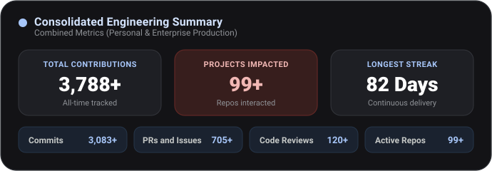
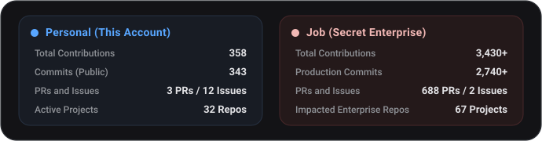
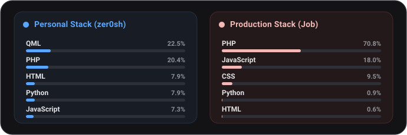

<div align="center">

  <!-- Header Banner -->
  

  <!-- Animated Typing Headline -->
  <a href="https://zer0sh.github.io/">
    
  </a>

  <br/>

  <a href="https://github.com/zer0sh" target="_blank">
    
  </a>

</div>

---

<h3 align="center">About Me</h3>

```yaml
engineer:
  focus: DevOps & Site Reliability Engineering (SRE)
  systems: [Arch Linux, Debian, Distributed Systems]
  ethos: "Automate toil, engineer resilience, understand the internals"
  passions: [Open Source, Linux & Kernel Tinkering, Observability, Cloud Native]
  portfolio: https://zer0sh.github.io/
  status: "Designing reliable infrastructure & continuously experimenting with new tech"
```

> I am a Systems Engineer focused on **DevOps & Site Reliability Engineering (SRE)**, driven by a genuine curiosity for how operating systems and distributed infrastructure operate under the hood.
>
> For me, reliability and automation are an engineering craft rather than just routine tasks. Deeply rooted in the **UNIX philosophy** and a staunch advocate for **Open Source**, my daily workflow revolves around Linux (Arch & Debian), terminal-first tooling, and understanding system behavior down to the bare essentials instead of treating platforms as black boxes.
>
> Beyond maintaining pipelines and clusters, I am a continuous experimenter. Whether it's dissecting internals, architecting cloud-native solutions, implementing observability, or exploring next-gen AI-augmented developer workflows, my approach is straightforward: **build it, test its breaking points, eliminate toil, and engineer it to endure.**

---

<h3 align="center">Tech Stack &amp; Toolbelt</h3>

<div align="center">

  <p align="center"><strong>DevOps, Cloud &amp; Systems</strong></p>
  <p align="center">
    <a href="https://www.docker.com/"></a>
    <a href="https://www.debian.org/"></a>
    <a href="https://archlinux.org/"></a>
    <a href="https://kernel.org/"></a>
    <a href="https://www.gnu.org/software/bash/"></a>
    <a href="https://git-scm.com/"></a>
  </p>

  <br/>

  <p align="center"><strong>Backend &amp; Core Engineering</strong></p>
  <p align="center">
    <a href="https://www.python.org/"></a>
    <a href="https://www.djangoproject.com/"></a>
    <a href="https://www.php.net/"></a>
    <a href="https://laravel.com/"></a>
    <a href="https://www.java.com/"></a>
    <a href="https://spring.io/"></a>
    <a href="https://isocpp.org/"></a>
    <a href="https://nodejs.org/"></a>
  </p>

  <br/>

  <p align="center"><strong>Frontend &amp; CMS</strong></p>
  <p align="center">
    <a href="https://react.dev/"></a>
    <a href="https://angular.dev/"></a>
    <a href="https://developer.mozilla.org/en-US/docs/Web/JavaScript"></a>
    <a href="https://wordpress.org/"></a>
    <a href="https://www.drupal.org/"></a>
  </p>

  <br/>

  <p align="center"><strong>Databases</strong></p>
  <p align="center">
    <a href="https://www.postgresql.org/"></a>
    <a href="https://mariadb.org/"></a>
    <a href="https://www.mysql.com/"></a>
  </p>

  <br/>

  <p align="center"><strong>Environments &amp; Editors</strong></p>
  <p align="center">
    <a href="https://code.visualstudio.com/"></a>
    <a href="https://www.vim.org/"></a>
  </p>

  <br/>

  <p align="center"><strong>AI Engineering &amp; Autonomous Coding</strong></p>
  <p align="center">
    <a href="https://deepmind.google/"></a>
    <a href="https://github.com/"></a>
    <a href="https://anthropic.com/"></a>
    <a href="https://openai.com/"></a>
  </p>

</div>

---

<h3 align="center">Currently Leveling Up &amp; Exploring (SRE / Cloud Native)</h3>

<div align="center">
  <p>
    <a href="https://kubernetes.io/"></a>
    <a href="https://opengitops.dev/"></a>
    <a href="https://argo-cd.readthedocs.io/"></a>
    <a href="https://helm.sh/"></a>
    <a href="https://prometheus.io/"></a>
    <a href="https://grafana.com/"></a>
    <a href="https://www.terraform.io/"></a>
  </p>
</div>

---

<h3 align="center">Activity &amp; Production Impact</h3>

<p align="center"><em>* Datos estimados al 18 de octubre de 2026</em></p>

<div align="center">

  <!-- 1. General Grande: Consolidated Summary (Suma automática de ambos) -->
  

  <br/><br/>

  <!-- 2. Breakdown: Personal (This Account) vs Job (Secret) -->
  

  <br/><br/>

  <!-- 3. Most Used Languages: Personal Stack vs Production Stack -->
  

</div>

---

<div align="center">

  <h3><em>"... el amor es la certeza de la vida. Es la sensación de la inmortalidad." ツ</em></h3>

  <!-- Footer Wave Banner -->
  

</div>
